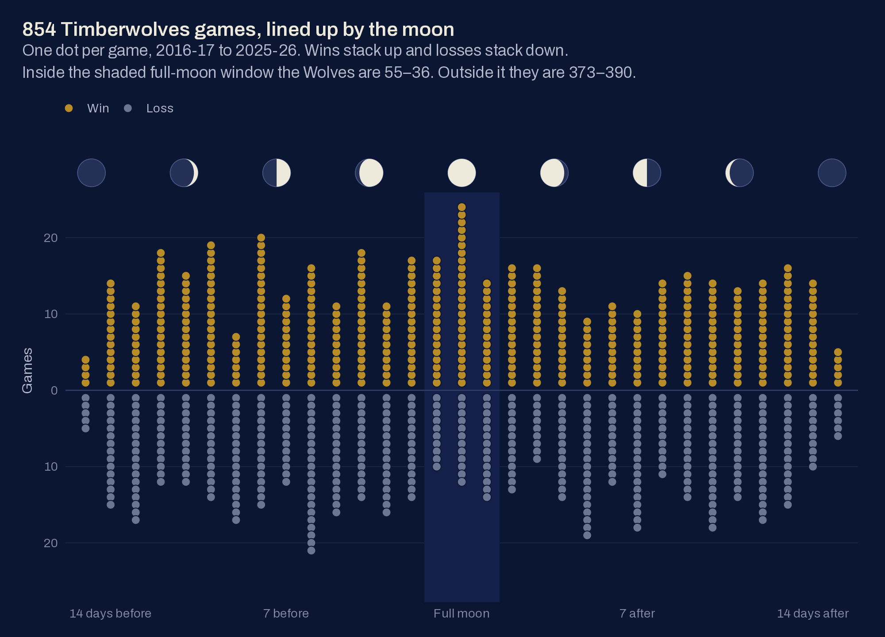

# The Timberwerewolves

Do the Minnesota Timberwolves play better under a full moon? Ten NBA seasons, tested in R.

The walkthrough, with every figure and number, is at <https://elkronos.github.io/the_timberwerewolves/>.



## What it found

From 2016-17 through 2025-26 the Wolves are 55–36 in games played within a day and a half of a full moon and 373–390 in all the others.

A model that compares them with the other 29 teams, and accounts for opponents, home court and rest, puts their full-moon edge at 1.7 points of margin, with a 95% interval from −1.2 to +4.6. The moon shows no effect on their scoring. Their opponents score 2.9 fewer points inside the full-moon window (p = 0.018). That is one of two results under 0.05 among sixteen estimates, and it does not survive a correction for the number of tests.

A check with 166 fake moons, cycles of made-up lengths, shows the error bars on the Wolves' margin are the right size and the ones on their defense are a little too narrow. About 2.9% of fake full-moon windows hold a record as good as the real one.

The fourteen seasons before those ten are a second sample that the main analysis never touched. There the Wolves went 45–70 near a full moon and 405–636 otherwise, and neither of the two flagged estimates has an interval that excludes zero.

Two seasons carry the record. The Wolves went 10–1 inside the window in 2021-22 and again in 2024-25, and 35–34 in the other eight seasons. Broken down by season and by team, the effect varies no more than luck would produce. The walkthrough has a chart where you can pick any team and switch between margin, points scored and points allowed.

The data cannot rule out an edge of a point or so. Confirming one from the main sample alone would take about 57 seasons of games.

## Run it

```sh
git clone https://github.com/elkronos/the_timberwerewolves
cd the_timberwerewolves
Rscript run_all.R
```

You need R and six packages. I tested on R 4.3 and R 4.5.

```r
install.packages(c("lme4", "Matrix", "suncalc", "ggplot2", "ragg", "jsonlite"))
```

The run takes six to ten minutes. It downloads 25 season files into `data-raw/`, fits the models, writes the tables in `results/`, draws the figures and rebuilds the site in `docs/`. To rerun one step, name it, as in `Rscript run_all.R figures`. The steps are `data`, `models`, `figures` and `site`.

`Rscript tests/run_tests.R` checks the building blocks and needs the testthat package.

## What is where

| Path | What it holds |
|---|---|
| `run_all.R` | The one script that runs everything |
| `R/config.R` | Seasons for both samples, the season in progress, team, window width and the pinned data commit |
| `R/data.R` | Download and cleaning, one row per game and per team-game |
| `R/moon.R` | The moon variables, computed with suncalc |
| `R/models.R` | The league mixed model, team slopes and Wolves-only regressions |
| `R/placebo.R` | The fake-moon test |
| `R/breakdown.R` | Each team's effect in each season, and records inside the window |
| `R/analysis.R` | Runs every model and writes `results/` |
| `R/theme_moon.R` | Colors, font, the ggplot theme and `geom_moon()` |
| `R/figures.R` | The twelve figures |
| `R/site.R` | Fills the page template with numbers from the results and writes the data for the interactive chart |
| `site/` | Page template, stylesheet, the three scripts and the figures' font |
| `checks/` | Four scripts behind claims in the changelog |
| `data/full_moons.csv` | Exact full-moon times for 2001 to 2036, made with PyEphem |
| `validation/` | The script that makes that table, and daily PyEphem values used to check suncalc |
| `results/` | Every table and number, as CSV and JSON |
| `docs/` | The built site, served by GitHub Pages |

## geom_moon

The figures draw the moon with a small ggplot2 geom. It takes `x`, `y` and a `phase` between 0 and 1 (0 is new, 0.5 is full), and its size is in millimetres so the disc stays round on any axis.

```r
library(ggplot2)
source("R/theme_moon.R")

month <- data.frame(day = seq(0, 28, by = 4))
ggplot(month, aes(day, 0)) +
  geom_moon(aes(x = day, y = 0, phase = day / 29.53), size = 12) +
  theme_moon()
```

## Sources

- Scores come from ESPN, collected by the [sportsdataverse](https://github.com/sportsdataverse/hoopR-nba-raw) project. The download is pinned to commit `4890b4e`.
- Moon positions come from the [suncalc](https://cran.r-project.org/package=suncalc) R package. The exact full-moon times in `data/full_moons.csv` come from [PyEphem](https://rhodesmill.org/pyephem/), which is also the yardstick suncalc is checked against.
- The models are fitted with [lme4](https://cran.r-project.org/package=lme4) and the figures drawn with [ggplot2](https://ggplot2.tidyverse.org).
- The typefaces are IM Fell English and Archivo. Both are under the SIL Open Font License, and the license texts are in `site/fonts/`.

This is a fan project. It is not affiliated with the Minnesota Timberwolves or the NBA.

## License

The code is under the [MIT license](LICENSE).
